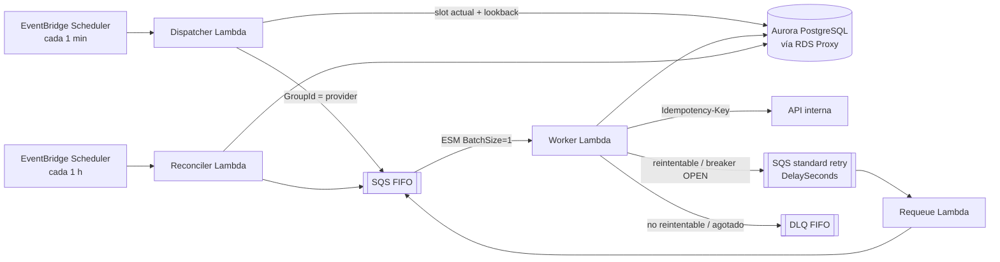

# Distributed Daily Scheduler (AWS)

Scheduler que ejecuta **una consulta diaria por registro** (1M hoy, diseñado para 10M) contra una API interna, distribuida a lo largo del día, con reintentos, circuit breaker y **sin concurrencia por proveedor**.

> [!IMPORTANT]
> **Implementación de referencia, no un sistema listo para producción.**
> Demuestra los algoritmos centrales (slot wheel, dispatch con lookback, Worker con claim/breaker/clasificación, Requeue, Reconciler) con código TypeScript ejecutable y testeado sobre **adaptadores en memoria** y un **reloj virtual**.
> **No incluye:** despliegue en AWS, pruebas contra servicios reales, adaptadores AWS completos, pruebas de carga reales (se reemplazan por una simulación en memoria, que no es un benchmark) ni hardening de producción, que se documenta como diseño objetivo.
> Nada en este repo fue desplegado ni medido en AWS.

## Arquitectura

Diagrama completo: [`docs/diagrams/arquitectura.excalidraw`](docs/diagrams/arquitectura.excalidraw).



## Correr localmente

Requiere Node.js 20+. No hace falta cuenta de AWS ni Docker.

```bash
npm install
npm run build
npm run lint
npm test                # unit + integración (en memoria)
npm run test:coverage   # umbral: 90% de líneas en src/core y src/common
```

Generar seeds para Postgres:

```bash
npm run seed:generate -- --rows 1000 --providers 50 --hot-provider 0.2 \
  --out database/seeds/registries.generated.sql
```

Las migraciones están en [`database/migrations/`](database/migrations/) (numeradas e idempotentes).

## Estado

| Fase (CLAUDE.md §12)                                      | Estado    |
| --------------------------------------------------------- | --------- |
| 1. Esqueleto: tooling, CI, `defaults`, migraciones, seeds | ✅        |
| 2. Núcleo puro                                            | ✅        |
| 3. Adaptadores en memoria y reloj virtual                 | ✅        |
| 4. Dispatcher                                             | ✅        |
| 5. Worker                                                 | ✅        |
| 6. Requeue y Reconciler                                   | ✅        |
| 7. Integración en memoria                                 | ✅        |
| 8. Simulación de escala                                   | pendiente |
| 9. Esqueleto CDK (opcional)                               | pendiente |
| 10. Documentación final                                   | pendiente |

## Documentación

Ver [`docs/`](docs/) (en español). El índice (`docs/00-indice.md`) se completa en la fase 10.

- [`docs/03-distribucion-diaria.md`](docs/03-distribucion-diaria.md)
- [`docs/04-concurrencia-por-proveedor.md`](docs/04-concurrencia-por-proveedor.md)
- [`docs/05-errores-reintentos-circuit-breaker.md`](docs/05-errores-reintentos-circuit-breaker.md)
- [`docs/06-idempotencia-y-consistencia.md`](docs/06-idempotencia-y-consistencia.md)
- [`docs/15-preguntas-abiertas.md`](docs/15-preguntas-abiertas.md)
