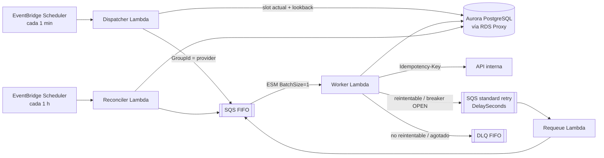

# Distributed Daily Scheduler (AWS)

Scheduler que ejecuta **una consulta diaria por registro** (1M hoy, diseñado para 10M) contra una API interna, distribuida a lo largo del día, con reintentos, circuit breaker y **sin concurrencia por proveedor**.

> [!IMPORTANT]
> **Implementación de referencia, no un sistema listo para producción.**
> Demuestra los algoritmos centrales (slot wheel, dispatch con lookback, Worker con claim/breaker/clasificación, Requeue, Reconciler) con código TypeScript ejecutable y testeado sobre **adaptadores en memoria** y un **reloj virtual**.
> **No incluye:** despliegue en AWS, pruebas contra servicios reales, adaptadores AWS completos, pruebas de carga reales (se reemplazan por una simulación en memoria, que no es un benchmark) ni hardening de producción, que se documenta como diseño objetivo.
> Nada en este repo fue desplegado ni medido en AWS.

## Arquitectura

Diagrama completo: [`docs/diagrams/arquitectura.excalidraw`](docs/diagrams/arquitectura.excalidraw).



## Correr localmente

Requiere Node.js 20+. No hace falta cuenta de AWS ni Docker.

```bash
npm install
npm run build
npm run lint
npm test                # unit + integración (en memoria)
npm run test:coverage   # umbral: 90% de líneas en src/core y src/common
```

Simulación de escala (un día completo sobre reloj virtual; **simulación, no benchmark de AWS**). 1M de registros tarda ~1,5 min y usa ~2,5 GB de RAM:

```bash
npm run simulate -- --rows 1000000 --providers 2000 --hot-provider 0.2
npm run simulate -- --rows 100000 --out reporte.md --json reporte.json   # guardar el reporte
```

Resultados de referencia en [`docs/simulacion/`](docs/simulacion/).

Generar seeds para Postgres:

```bash
npm run seed:generate -- --rows 1000 --providers 50 --hot-provider 0.2 \
  --out database/seeds/registries.generated.sql
```

Las migraciones están en [`database/migrations/`](database/migrations/) (numeradas e idempotentes; no se corrieron contra un PostgreSQL real).

Redrive de la DLQ (offline, sobre los mensajes exportados; ver [`docs/14-runbook.md`](docs/14-runbook.md)):

```bash
npm run redrive -- --in dlq-bodies.jsonl --out redrive/2026-03-01
```

## Estructura

```
src/
  common/      lógica pura: slot, clasificador, backoff, breaker, mensajes, tiempo, config, telemetría
  core/        Dispatcher, Worker, Requeue, Reconciler y los puertos (ports.ts)
  handlers/    los 4 handlers Lambda (finos: solo cablean)
  adapters/memory/  SQS FIFO y standard, PostgreSQL, S3, reloj, logger y métricas en memoria
  simulation/  simulador de la API interna, harness del pipeline y simulación de escala
database/      migraciones y seeds
scripts/       generador de seeds, simulación y redrive de la DLQ
tests/         unit/ · integration/ (pipeline completo) · simulation/ (escala reducida)
docs/          documentación, ADRs, diagrama y reportes de simulación
```

## Estado

| Fase (CLAUDE.md §12)                                      | Estado                                    |
| --------------------------------------------------------- | ----------------------------------------- |
| 1. Esqueleto: tooling, CI, `defaults`, migraciones, seeds | ✅                                        |
| 2. Núcleo puro                                            | ✅                                        |
| 3. Adaptadores en memoria y reloj virtual                 | ✅                                        |
| 4. Dispatcher                                             | ✅                                        |
| 5. Worker                                                 | ✅                                        |
| 6. Requeue y Reconciler                                   | ✅                                        |
| 7. Integración en memoria                                 | ✅                                        |
| 8. Simulación de escala                                   | ✅                                        |
| 9. Esqueleto CDK y adaptadores AWS (opcional)             | omitida (diseño en `docs/02` y `docs/12`) |
| 10. Documentación final                                   | ✅                                        |

## Documentación

En español, en [`docs/`](docs/). Empezar por el [índice y resumen ejecutivo](docs/00-indice.md).

| Documento                                                                                   | Tema                                                   |
| ------------------------------------------------------------------------------------------- | ------------------------------------------------------ |
| [00 — Índice y resumen ejecutivo](docs/00-indice.md)                                        | Resumen de una página y mapa de la documentación       |
| [01 — Contexto y supuestos](docs/01-contexto-y-supuestos.md)                                | Enunciado, alcance de la implementación, supuestos     |
| [02 — Arquitectura](docs/02-arquitectura.md)                                                | Diagrama, componentes, secuencias                      |
| [03 — Distribución diaria](docs/03-distribucion-diaria.md)                                  | Slot wheel, Dispatcher, lookback                       |
| [04 — Concurrencia por proveedor](docs/04-concurrencia-por-proveedor.md)                    | FIFO por proveedor, techo diario, simulación de escala |
| [05 — Errores, reintentos y circuit breaker](docs/05-errores-reintentos-circuit-breaker.md) | Clasificación, backoff, `retry`, breaker               |
| [06 — Idempotencia y consistencia](docs/06-idempotencia-y-consistencia.md)                  | Deduplicación, escenarios de falla, Reconciler         |
| [07 — Modelo de datos](docs/07-modelo-de-datos.md)                                          | DDL, índices, particiones, retención                   |
| [08 — Observabilidad](docs/08-observabilidad.md)                                            | Métricas, alarmas, logs                                |
| [09 — Seguridad](docs/09-seguridad.md)                                                      | Red, IAM, cifrado, secretos                            |
| [10 — Capacidad y costos](docs/10-capacidad-y-costos.md)                                    | Dimensionamiento y costo estimado para 1M y 10M        |
| [11 — Alternativas descartadas](docs/11-alternativas-descartadas.md)                        | Qué más se consideró y por qué no                      |
| [12 — Ciclo de vida de desarrollo](docs/12-ciclo-de-vida-de-desarrollo.md)                  | Branching, CI/CD, ambientes, rollback                  |
| [13 — Plan de desarrollo](docs/13-plan-de-desarrollo.md)                                    | Fases con entregables y Definition of Done             |
| [14 — Runbook](docs/14-runbook.md)                                                          | Alarmas y operaciones manuales                         |
| [15 — Preguntas abiertas](docs/15-preguntas-abiertas.md)                                    | Preguntas para el negocio y decisiones menores         |
| [ADRs](docs/adr/)                                                                           | Una por decisión D1–D12                                |
