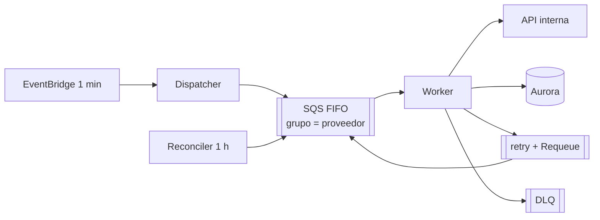

# 00 — Índice y resumen ejecutivo

## Resumen ejecutivo

**El problema.** Ejecutar una consulta diaria por registro contra una API interna (1M de registros hoy, 10M a futuro), repartida a lo largo del día, guardando cada resultado, reintentando solo los errores que tiene sentido reintentar y **sin llamadas concurrentes a un mismo proveedor**. Todo en AWS.

**La solución en una frase.** Cada registro tiene un minuto fijo del día (un hash de su id); un Dispatcher que corre cada minuto registra y encola los jobs de ese minuto en una **SQS FIFO con un grupo por proveedor**, que entrega como mucho un mensaje por proveedor a la vez; un Worker Lambda hace la llamada, guarda el resultado en Aurora y, si falla, decide entre reintentar con backoff (fuera de la FIFO, para no bloquear al proveedor), diferir por circuit breaker o mandar a la DLQ. Un Reconciler horario recupera lo que se haya perdido.

**Por qué esta arquitectura:**

| Requisito                      | Cómo se cumple                                                                                                            | Evidencia                                                                                             |
| ------------------------------ | ------------------------------------------------------------------------------------------------------------------------- | ----------------------------------------------------------------------------------------------------- |
| Distribuida en el día          | Slot wheel: `sha256(id) % 1440`, un schedule por minuto para toda la plataforma                                           | 694 jobs/min en promedio con 1M (mín. 585, máx. 787), calculado y simulado                            |
| Sin concurrencia por proveedor | Un grupo FIFO por proveedor + `BatchSize = 1`; sin locks propios                                                          | Pico de 1 llamada simultánea por proveedor en la integración y en la simulación de 1M                 |
| Errores reintentables o no     | Clasificador (5xx, 429, red, timeouts → reintenta; resto de 4xx → DLQ), backoff con jitter, circuit breaker por proveedor | Un test por rama del Worker; con 100% de 503, el breaker no deja pasar llamadas mientras está abierto |
| Guardar el resultado           | Aurora PostgreSQL particionada por mes, payloads grandes en S3                                                            | Ningún resultado perdido ni duplicado en los escenarios de crash                                      |
| Escala 1M → 10M                | Todo escala horizontal salvo el techo por proveedor, `86.400 / latencia` llamadas por día                                 | Simulación de 1M: el proveedor caliente llega a 144.056 llamadas contra 144.000 predichas             |

**Lo que hay que decidir antes de construir** (`15-preguntas-abiertas.md`): la distribución real de registros por proveedor y la latencia de la API (definen si algún proveedor supera su techo diario), si la API respeta `Idempotency-Key` y cuánta concurrencia admite cada proveedor.

**Costo estimado** (`10-capacidad-y-costos.md`, precios públicos de `us-east-1` del 2026-10-28, **sin medir**): ~$855 por mes con 1M y ~$4.800 con 10M, dominado por Aurora y por el Worker esperando a la API interna.

**Qué es este repo.** Una **implementación de referencia**: el diseño respaldado por código TypeScript ejecutable con 252 tests que corren sin AWS ni Docker, sobre adaptadores en memoria que reproducen la semántica de SQS y PostgreSQL. **Nada fue desplegado ni medido en AWS**; lo que no se implementó se documenta como diseño objetivo (`01-contexto-y-supuestos.md`).

## Mapa de la documentación

| Documento                                                                              | Contenido                                                                                                                                               |
| -------------------------------------------------------------------------------------- | ------------------------------------------------------------------------------------------------------------------------------------------------------- |
| [01 — Contexto y supuestos](01-contexto-y-supuestos.md)                                | El enunciado, qué incluye y qué no la implementación, supuestos explícitos.                                                                             |
| [02 — Arquitectura](02-arquitectura.md)                                                | Diagrama, componentes, secuencias end-to-end, ciclo de vida de una ejecución, puertos.                                                                  |
| [03 — Distribución diaria](03-distribucion-diaria.md)                                  | Slot wheel, jobs por minuto (1M y 10M), Dispatcher, lookback, día de negocio.                                                                           |
| [04 — Concurrencia por proveedor](04-concurrencia-por-proveedor.md)                    | FIFO y grupos, `BatchSize = 1`, techo `86.400 / latencia`, sharding `k`, simulación de escala.                                                          |
| [05 — Errores, reintentos y circuit breaker](05-errores-reintentos-circuit-breaker.md) | Clasificación, backoff, cola `retry` frente a la FIFO, breaker con diagrama de estados.                                                                 |
| [06 — Idempotencia y consistencia](06-idempotencia-y-consistencia.md)                  | `jobId`, claim, capas de deduplicación, escenarios de falla paso a paso, Reconciler, formato de la DLQ.                                                 |
| [07 — Modelo de datos](07-modelo-de-datos.md)                                          | DDL, índices, particiones, retención, S3, volumen.                                                                                                      |
| [08 — Observabilidad](08-observabilidad.md)                                            | Métricas, alarmas, dashboard, formato de logs, tracing.                                                                                                 |
| [09 — Seguridad](09-seguridad.md)                                                      | Red, IAM, cifrado, secretos, datos, amenazas.                                                                                                           |
| [10 — Capacidad y costos](10-capacidad-y-costos.md)                                    | Dimensionamiento y estimación mensual para 1M y 10M, con precios citados y fechados.                                                                    |
| [11 — Alternativas descartadas](11-alternativas-descartadas.md)                        | Schedule por job, `SKIP LOCKED`, locks en Redis o DynamoDB, Step Functions, Kinesis, cola por proveedor, reintentos en la FIFO, tabla diaria, DynamoDB. |
| [12 — Ciclo de vida de desarrollo](12-ciclo-de-vida-de-desarrollo.md)                  | Branching, CI (implementado), CD, ambientes, canary, rollback.                                                                                          |
| [13 — Plan de desarrollo](13-plan-de-desarrollo.md)                                    | Fases en vertical slices con entregable y Definition of Done.                                                                                           |
| [14 — Runbook](14-runbook.md)                                                          | Qué hacer ante cada alarma, redrive de la DLQ, breaker manual, re-despachos.                                                                            |
| [15 — Preguntas abiertas](15-preguntas-abiertas.md)                                    | Preguntas para el negocio, decisiones menores tomadas y fidelidad de los adaptadores en memoria.                                                        |
| [ADRs](adr/)                                                                           | Un ADR por cada decisión D1–D12.                                                                                                                        |
| [Diagrama](diagrams/arquitectura.excalidraw)                                           | Diagrama principal (Excalidraw).                                                                                                                        |
| [Simulación](simulacion/)                                                              | Reportes de la simulación de escala de 1M.                                                                                                              |

### ADRs

| ADR                                                   | Decisión                                                        |
| ----------------------------------------------------- | --------------------------------------------------------------- |
| [ADR-001](adr/ADR-001-slot-wheel.md)                  | Slot wheel de 1.440 minutos                                     |
| [ADR-002](adr/ADR-002-eventbridge-cada-minuto.md)     | EventBridge Scheduler cada minuto invoca al Dispatcher          |
| [ADR-003](adr/ADR-003-dispatch-windows-lookback.md)   | Ventanas de despacho y lookback de 5 slots                      |
| [ADR-004](adr/ADR-004-registrar-al-despachar.md)      | La ejecución se registra al despachar                           |
| [ADR-005](adr/ADR-005-fifo-por-proveedor.md)          | SQS FIFO con un grupo por proveedor                             |
| [ADR-006](adr/ADR-006-esm-batch-1.md)                 | Event source mapping con `BatchSize = 1` y `MaximumConcurrency` |
| [ADR-007](adr/ADR-007-reintentos-fuera-de-la-fifo.md) | Reintentos fuera de la FIFO: cola `retry` + Requeue             |
| [ADR-008](adr/ADR-008-circuit-breaker.md)             | Circuit breaker por proveedor en Aurora                         |
| [ADR-009](adr/ADR-009-dlq.md)                         | DLQ FIFO y DLQ de `retry`                                       |
| [ADR-010](adr/ADR-010-reconciler.md)                  | Reconciler cada hora                                            |
| [ADR-011](adr/ADR-011-aurora-particionada.md)         | Aurora PostgreSQL con RDS Proxy y particiones por mes           |
| [ADR-012](adr/ADR-012-idempotencia.md)                | Idempotencia de punta a punta                                   |

## Cómo leer esto según el tiempo disponible

- **5 minutos:** este resumen y el diagrama de `02-arquitectura.md`.
- **20 minutos:** además, `04` (concurrencia), `05` (errores) y `15` (preguntas abiertas).
- **Todo el diseño:** del `01` al `15` en orden; los ADRs para el porqué de cada decisión fija.
