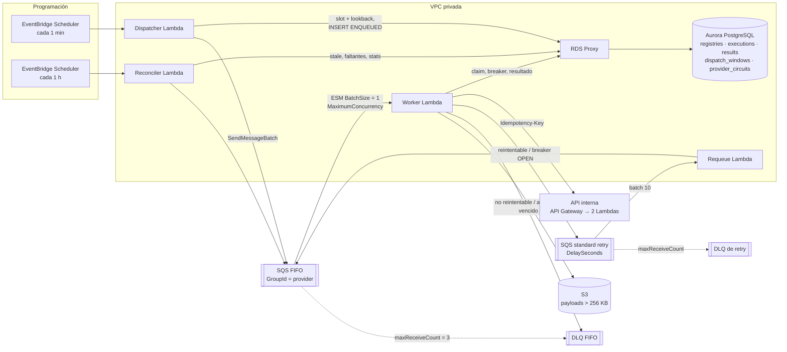
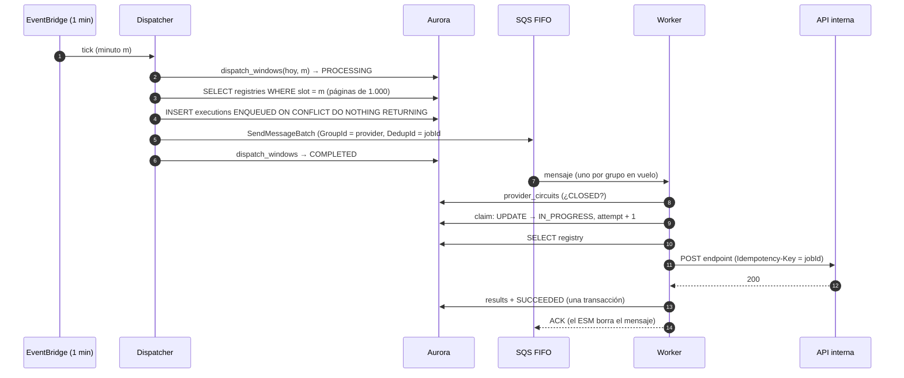
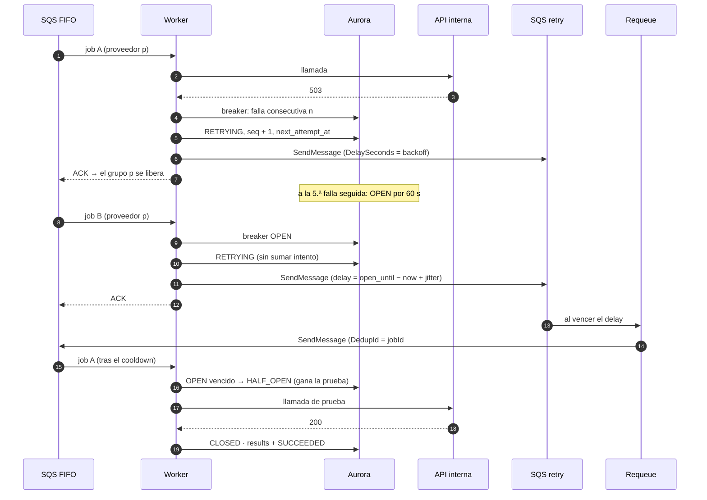
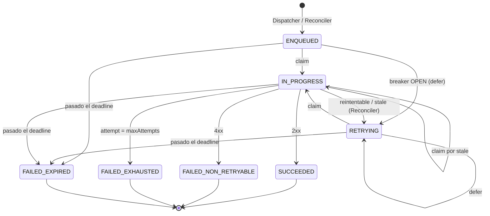

# 02 — Arquitectura

> Diseño objetivo en AWS. La implementación de referencia ejecuta la misma lógica sobre adaptadores en memoria; nada de esto fue desplegado.

## Diagrama

El diagrama completo, con anotaciones, está en [`diagrams/arquitectura.excalidraw`](diagrams/arquitectura.excalidraw) (abrir con [excalidraw.com](https://excalidraw.com)). Esta versión en Mermaid muestra los mismos componentes y flujos:

## Componentes

| Componente                    | Responsabilidad                                                                                                                                                                       | Decisión    | Código                                       |
| ----------------------------- | ------------------------------------------------------------------------------------------------------------------------------------------------------------------------------------- | ----------- | -------------------------------------------- |
| EventBridge Scheduler (1 min) | Dispara el Dispatcher una vez por minuto. Un solo schedule para toda la plataforma.                                                                                                   | D2          | —                                            |
| Dispatcher Lambda             | Despacha el slot del minuto y los 5 anteriores no completados: registra cada job como `ENQUEUED` y lo encola en la FIFO.                                                              | D1, D3, D4  | `src/core/dispatch/dispatcher.ts`            |
| SQS FIFO                      | Cola principal. `MessageGroupId = providerId` garantiza una llamada en curso por proveedor; `MessageDeduplicationId = jobId#seq` descarta duplicados por 5 min.                       | D5          | `src/adapters/memory/fifo-queue.ts`          |
| Event source mapping          | Invoca al Worker con `BatchSize = 1`; `MaximumConcurrency` acota la carga total sobre la API interna y Aurora.                                                                        | D6          | `src/simulation/harness.ts` (simulado)       |
| Worker Lambda                 | Deadline, circuit breaker, claim condicional, llamada a la API interna, clasificación del resultado y una de sus ramas (éxito, reintento, DLQ).                                       | D7, D8, D12 | `src/core/execute/worker.ts`                 |
| SQS standard `retry`          | Reintentos con `DelaySeconds` por mensaje (backoff o defer del breaker), fuera de la FIFO para no bloquear el grupo del proveedor.                                                    | D7          | `src/adapters/memory/standard-queue.ts`      |
| Requeue Lambda                | Devuelve a la FIFO los mensajes de `retry` cuando vence su delay. No toca la base.                                                                                                    | D7          | `src/core/execute/requeue.ts`                |
| DLQ FIFO                      | Cuarentena: no reintentables, intentos agotados, vencidos, inválidos y poison messages (redrive). Con alarma y camino de redrive.                                                     | D9          | `scripts/redrive-dlq.ts`                     |
| DLQ de `retry` (standard)     | Mensajes que la Requeue no pudo devolver a la FIFO tras `maxReceiveCount` intentos.                                                                                                   | D9          | —                                            |
| EventBridge Scheduler (1 h)   | Dispara el Reconciler.                                                                                                                                                                | D10         | —                                            |
| Reconciler Lambda             | Red de seguridad del día: re-encola `IN_PROGRESS` stale y registros sin ejecución; reporta `ENQUEUED` viejos y publica el % completado.                                               | D10         | `src/core/reconcile/reconciler.ts`           |
| Aurora PostgreSQL + RDS Proxy | Fuente de verdad: registros, ejecuciones (particionadas por mes), resultados, ventanas del Dispatcher y estado del breaker. El proxy multiplexa las conexiones de cientos de Lambdas. | D11         | `database/migrations/`                       |
| S3                            | Payloads de resultado mayores a 256 KB.                                                                                                                                               | D11         | `src/core/execute/worker.ts`                 |
| API interna                   | Fuera del sistema. Recibe `Idempotency-Key: jobId` y `X-Provider-Id`.                                                                                                                 | D12         | `src/simulation/api-simulator.ts` (simulada) |

## Secuencia end-to-end

### Camino feliz

### Reintento y circuit breaker

Los escenarios de falla (crashes, envíos fallidos, duplicados) están en `06-idempotencia-y-consistencia.md`.

## Ciclo de vida de una ejecución

## Arquitectura del código

Hexagonal liviana: los handlers (`src/handlers/`) solo cablean; la lógica vive en `src/core/` y depende de puertos (`src/core/ports.ts`, `src/common/telemetry.ts`); los adaptadores en memoria (`src/adapters/memory/`) implementan esos puertos para los tests y la simulación. Un adaptador AWS reemplazaría a cada uno sin tocar el núcleo:

| Puerto                                                   | Adaptador en memoria                         | Adaptador AWS (diseño objetivo)                     |
| -------------------------------------------------------- | -------------------------------------------- | --------------------------------------------------- |
| `FifoQueue`, `StandardQueue`                             | `InMemoryFifoQueue`, `InMemoryStandardQueue` | SQS (`SendMessage`, `SendMessageBatch`)             |
| `Repository` (registries, executions, windows, circuits) | `InMemoryRepository`                         | `pg` sobre RDS Proxy, con IAM auth                  |
| `InternalApi`                                            | `ApiSimulator`                               | `fetch` con `AbortSignal.timeout` y SigV4 si aplica |
| `ObjectStore`                                            | `InMemoryObjectStore`                        | S3 `PutObject`                                      |
| `Clock`                                                  | `VirtualClock`                               | `new Date()`                                        |
| `Logger`, `Metrics`                                      | `InMemoryLogger`, `InMemoryMetrics`          | Powertools Logger y Metrics (EMF)                   |
