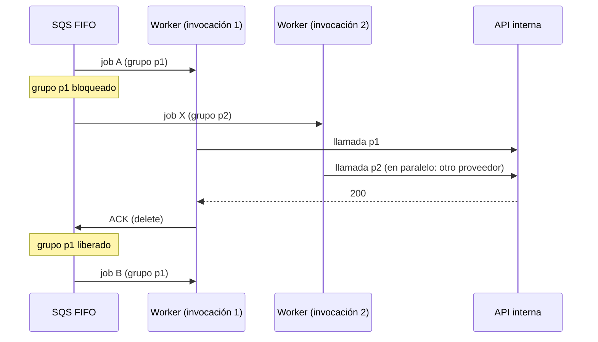

# 04 — Concurrencia por proveedor

El enunciado pide **evitar concurrencia a un mismo proveedor**. Este documento explica cómo lo garantiza el diseño, cuánto cuesta esa garantía y cómo se relaja si un proveedor lo permite. Decisiones: D5, D6. Código: `src/common/message.ts` (`groupId`), `src/adapters/memory/fifo-queue.ts`, `src/simulation/`.

## Mecanismo: un grupo FIFO por proveedor (D5)

Cada mensaje se envía a la SQS FIFO con `MessageGroupId = providerId`. SQS FIFO no entrega un mensaje de un grupo mientras otro mensaje del mismo grupo esté en vuelo (recibido y sin borrar). Con el Worker consumiendo **un mensaje por invocación** (`BatchSize = 1`, D6), "un mensaje en vuelo por grupo" equivale a "una llamada en curso por proveedor".



**Por qué así y no con locks:**

- **Sin coordinación propia.** La exclusión la hace SQS; no hay que mantener locks distribuidos (Redis, DynamoDB o `SELECT ... FOR UPDATE SKIP LOCKED`), con sus TTL, renovaciones y casos de dueño caído. Las alternativas están en `11-alternativas-descartadas.md`.
- **El orden por proveedor sale gratis**, aunque acá no se necesita.
- **El paralelismo entre proveedores es natural:** el event source mapping invoca Workers para grupos distintos en paralelo, acotado por `MaximumConcurrency`.

**Qué no rompe la garantía:**

- **Reintentos:** salen de la FIFO a la cola `retry` (D7), así que un job en backoff no ocupa el grupo; cuando vuelve, vuelve a hacer fila en su grupo.
- **Crash del Worker:** el mensaje sigue en vuelo hasta que vence el visibility timeout (180 s), así que el grupo sigue bloqueado y no entra otra llamada. La re-entrega encuentra la fila `IN_PROGRESS` y hace ACK sin llamar.
- **Timeout de la llamada:** el Worker abandona la llamada a los 10 s (`httpTimeoutMs`), muy por debajo del visibility timeout. Si la API interna siguiera procesando después del timeout, el proveedor podría ver un solape breve con la llamada siguiente; es un límite de cualquier cliente con timeout y queda **a verificar** con el equipo de la API (¿cancela la Lambda al cerrar la conexión?).

## Evidencia (simulación en memoria)

Los tests de integración (`tests/integration/end-to-end.test.ts`) corren el pipeline completo sobre un reloj virtual. El simulador de la API cuenta las llamadas simultáneas por proveedor, y la latencia transcurre en tiempo virtual, de modo que las invocaciones del Worker sí se solapan entre sí:

| Escenario (400 registros, 8 proveedores, 5xx/4xx/timeouts, `MaximumConcurrency = 100`) | Pico de llamadas simultáneas por proveedor |
| -------------------------------------------------------------------------------------- | ------------------------------------------ |
| `providerShards = 1` (configuración por defecto)                                       | **1**                                      |
| `providerShards = 4` (control: verifica que el test detecta solapes)                   | 4                                          |

El segundo caso es un control: con 4 grupos por proveedor el pico sube exactamente a 4, lo que muestra que la medición detecta solapes y que la garantía viene del grupo FIFO. Es una **simulación** de la semántica de SQS (ver las simplificaciones en `15-preguntas-abiertas.md`), no una medición en AWS.

## Costo: el techo por proveedor

Si cada proveedor procesa de a una llamada, un proveedor no puede completar más de

```
techo diario = 86.400 s / latencia media (s)
```

llamadas por día. Con 1 s de latencia son 86.400 llamadas; con 3 s, 28.800. Las dos Lambdas que ejecuta la API interna por llamada entran en esa latencia. Un proveedor con más registros que su techo **no termina en el día**: sus jobs se acumulan en la FIFO (`ENQUEUED` viejos en el reporte del Reconciler) y los que pasan el deadline terminan `FAILED_EXPIRED`.

### Simulación de escala: 1M de registros con un proveedor caliente

`npm run simulate -- --rows 1000000 --providers 2000 --hot-provider 0.2` corre un día completo del pipeline sobre el reloj virtual. Es una **simulación** con adaptadores en memoria y una API simulada (latencia uniforme 200–1.000 ms, media 0,6 s; 1% de 5xx; 0,5% de 4xx), **no un benchmark de AWS**. Los reportes completos están en [`simulacion/`](simulacion/).

| Proveedor caliente (`provider-00001`, 199.942 registros) | `MaximumConcurrency = 100` | `MaximumConcurrency = 1.000` |
| -------------------------------------------------------- | -------------------------- | ---------------------------- |
| Techo `86.400 / 0,6 s`                                   | 144.000                    | 144.000                      |
| Llamadas iniciadas dentro del día                        | 138.339                    | 144.056                      |
| Tiempo ocupado en llamadas dentro del día                | 96,2%                      | 100%                         |
| Exitosos dentro del día                                  | 136.213                    | 141.888                      |
| Exitosos en total (con las 6 h de gracia)                | 171.746                    | 177.404                      |
| Vencidos (`FAILED_EXPIRED`)                              | 27.320                     | 21.643                       |
| Mayor demora de un job                                   | 18,05 h                    | 20,18 h                      |

Qué muestra:

- **El techo es real y la fórmula lo predice.** Con el proveedor ocupado el 100% del tiempo, las llamadas del día (144.056) coinciden con `86.400 / latencia media`. Un proveedor por encima de su techo no termina: el backlog crece todo el día, los jobs llegan a esperar 18 h y los que pasan el deadline (fin del día + 6 h) terminan `FAILED_EXPIRED`, visibles en la DLQ.
- **El proveedor caliente no afecta a los demás.** Los otros 1.999 proveedores terminan cada job con una demora p95 de 14 s desde que se encola (máximo 55 s) y su último job del día termina a las 23:59. Es la ventaja de un grupo por proveedor: el backlog de uno no bloquea a otros grupos.
- **Hallazgo: la ráfaga de cada minuto le resta capacidad al proveedor caliente.** Con `MaximumConcurrency = 100`, el proveedor caliente quedó ocioso el 3,8% del día a pesar de tener backlog: unos 2,3 s al comienzo de cada minuto. El Dispatcher encola los ~694 jobs del minuto de una vez, ~600 grupos quedan listos al mismo tiempo y, con 100 Workers como máximo, el grupo caliente espera su turno detrás de ellos. Con 1.000 el efecto desaparece. Mitigaciones posibles: dimensionar `MaximumConcurrency` para la ráfaga y no para el promedio (~7 llamadas en curso), o repartir los envíos dentro del minuto. Que SQS FIFO reparta los grupos listos con el mismo orden que el adaptador en memoria (round-robin) es **a verificar**: la documentación de SQS no garantiza un orden entre grupos.

**Qué hacer con un proveedor caliente:** si admite concurrencia, sharding `k` (abajo); si no, el problema no se resuelve repartiendo mejor en el día, porque ya está ocupado todo el día: hay que negociar más capacidad, bajar la latencia o aceptar una frecuencia menor que diaria para ese proveedor. Detectarlo es simple: `EnqueuedStale` del Reconciler y `PendingByProvider` crecen durante el día.

## Sharding `k`: relajar la garantía de forma explícita

Si un proveedor admite `k` llamadas concurrentes, el grupo pasa a ser `providerId#shard` con `shard = uint32(sha256(registryId)[4..8]) % k`:

- el techo se multiplica por `k`;
- la concurrencia máxima hacia ese proveedor pasa a ser exactamente `k` (lo muestra el control de la tabla);
- cada registro cae siempre en el mismo shard, y el shard usa bytes del hash distintos a los del slot para que no se correlacione con el minuto.

Hoy `providerShards` es global (un solo valor en `defaults`). Un valor por proveedor necesitaría un mapa de configuración, fuera de alcance de la implementación de referencia; cuánta concurrencia admite cada proveedor es una pregunta abierta (`15-preguntas-abiertas.md`).

## `MaximumConcurrency` del event source mapping (D6)

Acota cuántos Workers corren a la vez **en total**, no por proveedor. Protege a la API interna (cada llamada son 2 Lambdas) y a Aurora (cada Worker usa conexiones vía RDS Proxy). Con N proveedores activos y `MaximumConcurrency = M`, como mucho `min(N, M)` llamadas están en curso. El dimensionamiento está en `10-capacidad-y-costos.md`.
