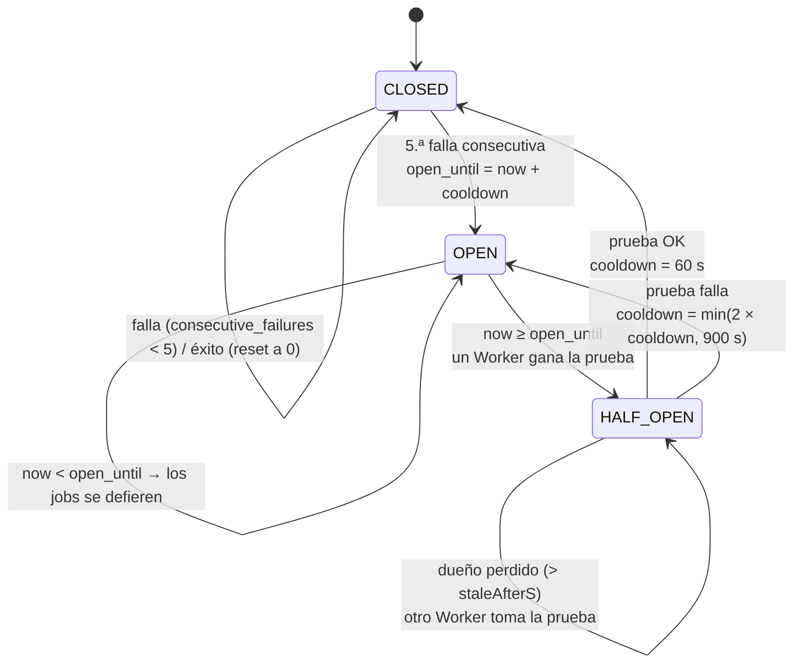

# 05 — Errores, reintentos y circuit breaker

> Implementación de referencia. Los algoritmos de este documento están implementados y testeados como funciones puras en `src/common/` (`error-classifier.ts`, `backoff.ts`, `circuit-breaker.ts`). El cableado con el Worker llega en la fase 5. Nada fue medido en AWS.

## 1. Clasificación de errores

El Worker clasifica cada resultado de la llamada a la API interna en una de tres clases. La clase decide qué hace el Worker y si el resultado cuenta para el circuit breaker.

| Caso                                                                                              | Clase           | Cuenta para el breaker | Notas                                                 |
| ------------------------------------------------------------------------------------------------- | --------------- | ---------------------- | ----------------------------------------------------- |
| 2xx                                                                                               | `SUCCESS`       | éxito                  |                                                       |
| 408, 425, 429, 500, 502, 503, 504                                                                 | `RETRYABLE`     | sí                     | 429 y 503 respetan `Retry-After` (segundos o fecha)   |
| Throttling de Lambda / API Gateway (`x-amzn-ErrorType` o `error.name`)                            | `RETRYABLE`     | sí                     | Gana sobre el status: un 400 con throttling reintenta |
| Red: `error.code` en `ECONNRESET`, `ETIMEDOUT`, `ECONNREFUSED`, `EAI_AGAIN`, `EPIPE`, `UND_ERR_*` | `RETRYABLE`     | sí                     | Se recorre `error.cause` (así envuelve `fetch`)       |
| Timeout: `error.name` `AbortError` / `TimeoutError`                                               | `RETRYABLE`     | sí                     |                                                       |
| Resto de 4xx                                                                                      | `NON_RETRYABLE` | **no**                 | 401/403 marcan `credentialAlarm`                      |
| Cualquier otra cosa (error desconocido, 1xx, 3xx, 5xx fuera de la lista)                          | `RETRYABLE`     | sí                     | Acotado por `maxAttempts`                             |

**Por qué así:**

- **`error.code` y `error.name`, nunca el mensaje.** Los mensajes cambian entre versiones de Node y de undici; los códigos son contrato. Un test verifica que un `Error('ECONNRESET happened')` sin `code` no se clasifica como error de red.
- **Los 4xx no cuentan para el breaker.** Un 404 o un 422 dicen que _ese registro_ está mal, no que el proveedor esté caído. Si contaran, un lote de registros mal cargados abriría el circuito y frenaría a los registros sanos del mismo proveedor.
- **Ante la duda, reintentar acotado.** Perder un job por un error que no supimos clasificar es peor que gastar hasta `maxAttempts` llamadas. El costo está acotado y el job termina en la DLQ con `FAILED_EXHAUSTED`, donde es visible.
- **`Retry-After` sin tope en el clasificador.** El clasificador devuelve el valor tal cual; el tope de 900 s (`maxDelayS`, límite de `DelaySeconds` de SQS, a verificar en la documentación de SQS) lo aplica `retryDelayS`. Así cada función tiene una sola responsabilidad.

## 2. Backoff

```
delay(n) = random(0, min(maxDelayS, retryBaseS × 2^(n-1)))     // full jitter, en segundos enteros
```

Con los `defaults` (`retryBaseS = 10`, `maxDelayS = 900`, `maxAttempts = 8`), el techo de cada intento es:

| Intento (n) | 1   | 2   | 3   | 4   | 5   | 6   | 7   | 8   |
| ----------- | --- | --- | --- | --- | --- | --- | --- | --- |
| Techo (s)   | 10  | 20  | 40  | 80  | 160 | 320 | 640 | 900 |

Con `maxAttempts = 8` hay como máximo 7 reintentos, con delays `backoff(1)` a `backoff(7)` (tras la n-ésima llamada fallida se agenda `backoff(n)`). La suma de esos techos es 1.270 s ≈ 21 min (sin contar defers del breaker): en el peor caso un job agota sus intentos bastante antes del deadline (`endOf(runDate) + expiryGraceH`). El tope de 900 s entra en juego con `maxAttempts` más altos o con `Retry-After`.

**Full jitter** (y no un jitter parcial) porque, cuando un proveedor falla, falla para muchos jobs a la vez. Con jitter completo los reintentos se reparten de forma uniforme en toda la ventana en lugar de volver en ráfaga. Si viene `Retry-After`, se respeta en lugar del backoff (con el mismo tope).

## 3. La cola `retry` frente a reintentar en la misma FIFO

Los reintentos salen de la FIFO principal hacia una cola **standard** `retry` con `DelaySeconds` por mensaje; una Requeue Lambda los devuelve a la FIFO cuando vence el delay (D7).

| Opción                                                      | Problema                                                                                                                                                                                                                       |
| ----------------------------------------------------------- | ------------------------------------------------------------------------------------------------------------------------------------------------------------------------------------------------------------------------------ |
| Reintentar en la FIFO (no hacer ACK, esperar la visibility) | Mientras el mensaje está en vuelo, **todo el grupo del proveedor queda bloqueado**: un job con backoff de 10 min frena a todos los demás jobs del proveedor. Además el delay queda atado al visibility timeout, no al backoff. |
| `DelaySeconds` en la FIFO                                   | Las colas FIFO no admiten delay por mensaje, solo por cola (a verificar en la documentación de SQS).                                                                                                                           |
| **Cola standard `retry` + Requeue (elegida)**               | El grupo se libera enseguida (ACK) y el delay es por mensaje. Costo: una Lambda más y un salto extra. Se pierde el orden, que acá no importa: cada job es independiente.                                                       |

La consecuencia de liberar el grupo es que, sin protección, los jobs siguientes del mismo proveedor seguirían golpeando a un proveedor caído. Esa es la razón del circuit breaker (D8).

## 4. Circuit breaker por proveedor

Un breaker por proveedor, persistido en `provider_circuits` (Aurora). La lógica de transición es una función pura (`transition(state, event, now, config)`) y la decisión de admisión otra (`admit(state, owner, now, config)`); el adaptador persiste el resultado con un `UPDATE` condicionado a la fila leída, de modo que las carreras se resuelven en la base.



**Parámetros:** `cbFailureThreshold = 5`, `cbBaseCooldownS = 60`, `cbMaxCooldownS = 900`, `staleAfterS = 360`.

**Admisión (`admit`):**

| Estado                                  | Decisión                                                 |
| --------------------------------------- | -------------------------------------------------------- |
| sin fila o `CLOSED`                     | `ALLOW`                                                  |
| `OPEN`, `now < open_until`              | `DEFER` hasta `open_until`                               |
| `OPEN`, `now ≥ open_until`              | `PROBE`: intentar `ACQUIRE_PROBE`; si se pierde, deferir |
| `HALF_OPEN`, dueño = yo o dueño perdido | `PROBE`                                                  |
| `HALF_OPEN`, otro dueño vivo            | `DEFER` por `cbBaseCooldownS`                            |

Un job deferido vuelve a la cola `retry` con `delay = min(900, open_until − now + jitter(0..30 s))`, `seq + 1` y **sin sumar `attempt`**: no hubo llamada real.

**Decisiones finas y su porqué:**

- **Solo la prueba cierra el circuito.** Un éxito que llega con el circuito `OPEN` (o en `HALF_OPEN` de otro dueño) es una llamada que empezó antes de abrir; no prueba que el proveedor se haya recuperado ahora. Se ignora. Lo mismo con las fallas tardías: el circuito ya está abierto.
- **Una única llamada de prueba.** Si todos los Workers que ven `open_until` vencido llamaran a la vez, un proveedor que recién se recupera recibiría una ráfaga. La transición `OPEN → HALF_OPEN` es atómica y solo uno la gana; los demás se defieren.
- **Cooldown exponencial con tope.** Un proveedor que sigue caído recibe una prueba cada 60, 120, 240, 480 y luego 900 s, en lugar de una por minuto indefinidamente. Al cerrar, el cooldown vuelve a la base.
- **Dueño perdido.** Si el Worker de la prueba muere (timeout de Lambda, crash), el circuito quedaría en `HALF_OPEN` para siempre. Pasado `staleAfterS` sin reporte, otro Worker toma la prueba.
- **Los no-dueños en `HALF_OPEN` se defieren por `cbBaseCooldownS` (60 s)** y no hasta que venza el dueño (6 min): la prueba normalmente termina dentro de un `httpTimeoutMs`, así que un minuto alcanza para volver a mirar sin castigar a los jobs si la prueba sale bien.

**Trade-off principal:** el breaker vive en Aurora, lo que agrega una lectura por job y una escritura por falla. Es aceptable porque el Worker ya escribe en Aurora en cada job (claim y resultado) y evita sumar otro almacén (Redis, DynamoDB) solo para esto. Ver `11-alternativas-descartadas.md`.
