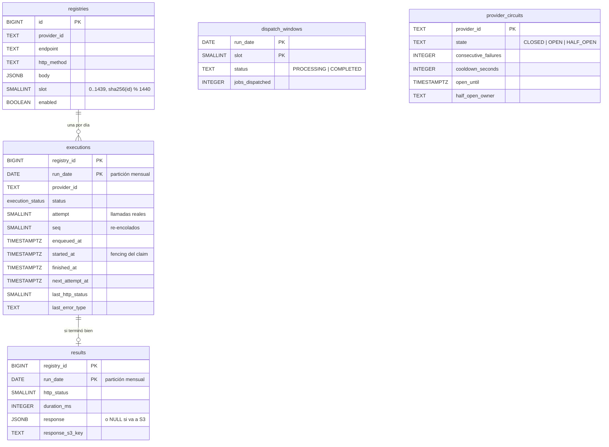

# 07 — Modelo de datos

Aurora PostgreSQL 16 detrás de RDS Proxy (D11). El DDL está en [`database/migrations/`](../database/migrations/), en archivos numerados e idempotentes (`IF NOT EXISTS`, `CREATE OR REPLACE`). Las migraciones **no se corrieron contra un PostgreSQL real** en este repo (ver `15-preguntas-abiertas.md`).

## Tablas

| Migración                           | Contenido                                                                                         |
| ----------------------------------- | ------------------------------------------------------------------------------------------------- |
| `001_types.sql`                     | El enum `execution_status` (7 estados).                                                           |
| `002_registries.sql`                | La tabla del enunciado más `slot`, `enabled` y timestamps; índices.                               |
| `003_executions_results.sql`        | `executions` y `results`, particionadas por `RANGE (run_date)`.                                   |
| `004_dispatch_windows_circuits.sql` | Las ventanas del Dispatcher y el estado del breaker, con `CHECK` de consistencia.                 |
| `005_partition_management.sql`      | `ensure_monthly_partitions` y `drop_expired_partitions`; crea el mes actual y los dos siguientes. |

**Por qué relacional (y no DynamoDB):** el diseño depende de cuatro cosas que PostgreSQL da directamente: `UNIQUE(registry_id, run_date)` con `INSERT ... ON CONFLICT DO NOTHING RETURNING` (D4, D12), `UPDATE ... WHERE <estado esperado> RETURNING` para claims y transiciones atómicas, consultas por rango para el Reconciler (registros de slots vencidos sin ejecución: un anti-join) y la paginación keyset del Dispatcher. Con DynamoDB las tres primeras son posibles (escrituras condicionales), pero el anti-join y los conteos por estado y proveedor obligarían a índices secundarios y a mantener contadores a mano. La comparación completa está en `11-alternativas-descartadas.md`.

## Índices

| Índice                                                      | Consulta que sirve                                                                                                                                          |
| ----------------------------------------------------------- | ----------------------------------------------------------------------------------------------------------------------------------------------------------- |
| `registries (slot, id) INCLUDE (provider_id) WHERE enabled` | Dispatcher: `WHERE slot = $1 AND enabled AND id > $cursor ORDER BY id LIMIT 1000` (index-only, keyset). También el Reconciler, que pagina por `(slot, id)`. |
| `registries (provider_id)`                                  | Operación: "todos los registros de un proveedor" (runbook, re-despachos).                                                                                   |
| `executions PK (registry_id, run_date)`                     | Claim, transiciones y la unicidad diaria (D12).                                                                                                             |
| `executions (run_date, status)`                             | Reconciler: stale (`IN_PROGRESS`), `ENQUEUED` viejos y conteos por estado.                                                                                  |
| `executions (provider_id, run_date)`                        | Conteos y backlog por proveedor (`PendingByProvider`), investigación de incidentes.                                                                         |
| `dispatch_windows (started_at) WHERE status = 'PROCESSING'` | Alarma "ventana `PROCESSING` con más de 10 min".                                                                                                            |

**Por qué `(slot, id)` y no `(slot) INCLUDE (id, …)` como dice CLAUDE.md §4:** con `id` en la clave, la paginación recorre el índice en orden sin ordenar en memoria. Cubre las mismas columnas (decisión menor en `15-preguntas-abiertas.md`).

## Particiones y retención

`executions` y `results` acumulan una fila por registro por día: **unos 365M de filas por año con 1M de registros** y 3.650M con 10M. Se particionan por mes sobre `run_date` (D11):

- **Las consultas calientes tocan una o dos particiones.** Todo lo que hace el sistema filtra por `run_date` (hoy y, cerca de medianoche, ayer).
- **La retención es un `DROP`, no un `DELETE`.** `drop_expired_partitions('executions', 13)` elimina las particiones cuyo rango completo es más viejo que 13 meses: es instantáneo, no genera bloat ni carga de vacuum. Un `DELETE` de 30M de filas por mes sí lo haría.
- **Las particiones futuras se crean por adelantado.** `ensure_monthly_partitions(tabla, current_date, 2)` mantiene siempre el mes actual y dos más. Si un job programado deja de correr, quedan dos meses de margen antes de que un `INSERT` falle por falta de partición. Quién invoca estas funciones (un EventBridge Scheduler mensual con una Lambda, o `pg_cron` si está disponible en Aurora, **a verificar**) es diseño objetivo; la alarma correspondiente es "no existe la partición del mes siguiente".
- **La clave primaria incluye la columna de partición**, como exige PostgreSQL para las restricciones únicas en tablas particionadas; por eso es `(registry_id, run_date)` y no un id sintético.

## Payloads grandes en S3

`results.response` es `JSONB` para respuestas de hasta `resultInlineMaxBytes` (256 KB). Las más grandes se guardan en S3 (`results/<run_date>/<registry_id>.json`) y la fila guarda `response_s3_key`. Un `CHECK` exige que esté exactamente uno de los dos.

**Por qué 256 KB:** es el tamaño máximo de un mensaje SQS (**a verificar** en las cuotas de SQS), una referencia natural de "payload grande" en el resto del sistema, y por encima de ese tamaño el `JSONB` empieza a pesar en TOAST, en el WAL y en los backups. Las respuestas típicas se suponen de ~1 KB (supuesto S8), así que S3 es la excepción.

**Ciclo de vida en S3:** una regla de lifecycle con la misma retención (13 meses) mantiene consistentes la base y el bucket.

## Volumen estimado

Supuestos: ~1 KB de respuesta por resultado (S8), ~150 bytes por fila de `executions`, índices incluidos aproximadamente con un factor de 2. Son **estimaciones**, no mediciones.

| Registros | Filas nuevas por mes (`executions` + `results`) | Crecimiento por mes | En régimen (13 meses) |
| --------- | ----------------------------------------------- | ------------------- | --------------------- |
| 1M        | 30M + ~30M                                      | ~55 GB              | ~700 GB               |
| 10M       | 300M + ~300M                                    | ~550 GB             | ~7 TB                 |

El tamaño real de las respuestas es una pregunta abierta y el factor que más mueve esta tabla (y el costo de almacenamiento, `10-capacidad-y-costos.md`). Si las respuestas fueran de decenas de KB, convendría guardar todas en S3 y dejar en Aurora solo los metadatos.

## Escrituras por job

| Paso             | Sentencia                                                                          | Filas |
| ---------------- | ---------------------------------------------------------------------------------- | ----- |
| Dispatcher       | `INSERT executions ... ON CONFLICT DO NOTHING` (en lotes de 1.000)                 | 1     |
| Worker: breaker  | `SELECT provider_circuits` (y un `UPDATE` solo si cambia)                          | 0–1   |
| Worker: claim    | `UPDATE executions ... RETURNING`                                                  | 1     |
| Worker: registro | `SELECT registries`                                                                | 0     |
| Worker: éxito    | `INSERT results ... ON CONFLICT DO UPDATE` + `UPDATE executions` (una transacción) | 2     |

Unas 4 escrituras por job en el camino feliz: ~46 por segundo en promedio con 1M y ~460 con 10M, más el pico del comienzo de cada minuto. El breaker escribe una fila por proveedor solo cuando su estado cambia (los éxitos con `consecutive_failures = 0` no escriben), así que no se vuelve un punto caliente.
