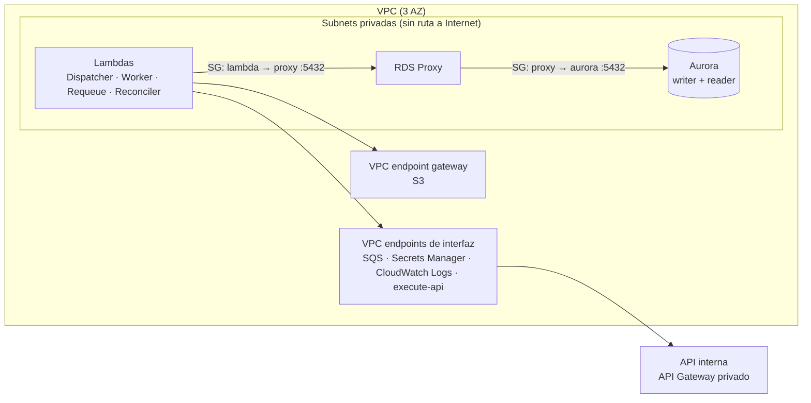

# 09 — Seguridad

> **Diseño objetivo.** Nada de este documento está implementado ni desplegado: la implementación de referencia no tiene IaC (la fase 9 se omitió). Lo que sí está en el código es lo que reduce la superficie de error: validación de cada mensaje con `zod`, ninguna dependencia de AWS en el núcleo y ningún secreto en el repo (CI con escaneo de secretos).

## Red

- **Lambdas en subnets privadas multi-AZ, sin NAT.** Todo el tráfico a servicios de AWS sale por VPC endpoints. No hay ruta a Internet: si una dependencia intentara salir, falla en lugar de exfiltrar.
- **Security groups encadenados:** el de las Lambdas solo puede hablar con el del proxy en el puerto 5432; el del proxy, solo con el de Aurora. Aurora no acepta conexiones de ningún otro origen.
- **API interna privada:** API Gateway de tipo privado, accesible solo a través del endpoint `execute-api`, con una resource policy que limita el acceso a ese endpoint (`aws:SourceVpce`).
- **Por qué endpoints y no NAT:** el NAT Gateway cobra por hora y por GB procesado, y abre una salida a Internet que el sistema no necesita. Los endpoints de interfaz también cobran por hora y AZ (`10-capacidad-y-costos.md`), pero mantienen todo el tráfico dentro de la red de AWS.

## IAM: un rol por Lambda, mínimo privilegio

| Lambda     | Permisos                                                                                                                                                                                                                                                                                                                                                        |
| ---------- | --------------------------------------------------------------------------------------------------------------------------------------------------------------------------------------------------------------------------------------------------------------------------------------------------------------------------------------------------------------- |
| Dispatcher | `sqs:SendMessage` en la FIFO; `rds-db:connect` como usuario `dispatcher`; logs.                                                                                                                                                                                                                                                                                 |
| Worker     | Lo que necesita el ESM de la FIFO (`ReceiveMessage`, `DeleteMessage`, `ChangeMessageVisibility`, `GetQueueAttributes`); `sqs:SendMessage` en `retry` y en la DLQ FIFO; `s3:PutObject` en `results/*`; `execute-api:Invoke` en la API interna; `rds-db:connect` como `worker`; `kms:GenerateDataKey`/`kms:Decrypt` en las claves de las colas y el bucket; logs. |
| Requeue    | Lo que necesita el ESM de `retry`; `sqs:SendMessage` en la FIFO y en la DLQ FIFO; logs. **Sin acceso a la base.**                                                                                                                                                                                                                                               |
| Reconciler | `sqs:SendMessage` en la FIFO; `rds-db:connect` como `reconciler`; logs.                                                                                                                                                                                                                                                                                         |

**Usuarios de base por componente,** con permisos de PostgreSQL mínimos:

| Usuario      | `registries` | `executions`             | `results`        | `dispatch_windows`       | `provider_circuits`      |
| ------------ | ------------ | ------------------------ | ---------------- | ------------------------ | ------------------------ |
| `dispatcher` | `SELECT`     | `SELECT, INSERT`         | —                | `SELECT, INSERT, UPDATE` | —                        |
| `worker`     | `SELECT`     | `SELECT, UPDATE`         | `INSERT, UPDATE` | —                        | `SELECT, INSERT, UPDATE` |
| `reconciler` | `SELECT`     | `SELECT, INSERT, UPDATE` | —                | —                        | —                        |

Ninguno puede hacer `DELETE` ni DDL. Las migraciones y el mantenimiento de particiones corren con un usuario de despliegue distinto, desde el pipeline de CI/CD.

**Autenticación a la base con IAM** (a través del RDS Proxy): las Lambdas no manejan contraseñas; el proxy obtiene las credenciales de Aurora desde Secrets Manager con rotación automática.

## Cifrado

- **En reposo, con KMS** (claves administradas por el cliente, una por dominio de datos): Aurora (incluye snapshots y backups), las 4 colas SQS, el bucket de resultados y los logs de CloudWatch.
- **En tránsito:** TLS obligatorio hacia el RDS Proxy y Aurora (`rds.force_ssl = 1`), HTTPS hacia la API interna y hacia los endpoints de AWS; el bucket con una policy que niega `aws:SecureTransport = false`.
- **Por qué claves propias y no las administradas por AWS:** permiten auditar en CloudTrail quién descifra qué, y revocar el acceso a los datos deshabilitando una clave.

## Secretos

- **Credenciales de la API interna:** si usa IAM (`execute-api:Invoke` con SigV4), no hay secreto. Si usa tokens, van en Secrets Manager con rotación, se leen al iniciar la Lambda y se cachean con TTL corto. Nunca en variables de entorno en texto plano.
- **El 401/403 dispara una alarma, no un reintento** (`CredentialErrors`): un secreto vencido no se arregla reintentando y cada intento gastaría capacidad del proveedor.
- **Repositorio:** escaneo de secretos (gitleaks) en cada push y PR (`.github/workflows/ci.yml`). `.env*` está en `.gitignore`.

## Datos

- `registries.body` y `results.response` pueden contener datos de clientes. Acceso de lectura humano solo con un rol de soporte auditado; los logs **no** incluyen el body ni la respuesta (solo ids, estados y tipos de error), y así está escrito el Worker.
- Los mensajes de las colas solo llevan ids y contadores (`JobMessage`), no el contenido de la consulta: el Worker lee el registro de la base. Un mensaje filtrado de una DLQ no expone datos.
- La retención de 13 meses se aplica con `DROP` de particiones y con la regla de lifecycle de S3.

## Amenazas consideradas

| Amenaza                                                      | Mitigación                                                                                                     |
| ------------------------------------------------------------ | -------------------------------------------------------------------------------------------------------------- |
| Un mensaje malformado o manipulado en una cola               | Validación con `zod` en cada consumidor; si no valida, va a la DLQ con `INVALID_MESSAGE` y no se ejecuta.      |
| Un job ejecutado dos veces                                   | Claim condicional, `UNIQUE(registry_id, run_date)` e `Idempotency-Key` (`06-idempotencia-y-consistencia.md`).  |
| Saturar a un proveedor (propio bug o tormenta de reintentos) | Un grupo FIFO por proveedor, circuit breaker, backoff con jitter y `MaximumConcurrency`.                       |
| Credenciales filtradas                                       | Sin contraseñas en Lambdas (IAM auth), Secrets Manager con rotación, escaneo de secretos en CI.                |
| Exfiltración desde una Lambda comprometida                   | Sin salida a Internet; roles con mínimo privilegio; endpoints con policies que limitan a los recursos propios. |
| Borrado masivo de datos                                      | Ningún usuario de aplicación tiene `DELETE`; backups de Aurora con retención y snapshots cifrados.             |
