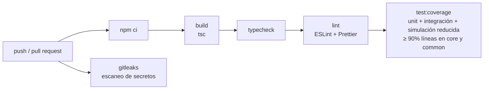
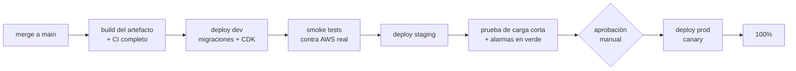

# 12 — Ciclo de vida de desarrollo

> Lo que **existe hoy** en el repo: el pipeline de CI en GitHub Actions (build, typecheck, lint, tests con umbral de cobertura y escaneo de secretos). Lo demás (IaC, ambientes, despliegues, canary) es **diseño objetivo**.

## Branching y commits

- **Trunk-based:** `main` siempre desplegable. Ramas cortas (`feat/...`, `fix/...`) que viven horas o pocos días y entran por pull request.
- **PR obligatorio** con CI en verde y una revisión. Sin pushes directos a `main` (branch protection).
- **Conventional Commits** (`feat:`, `fix:`, `docs:`, `refactor:`, `chore:`): permiten generar el changelog y decidir el bump de versión.
- **Feature flags** para cambios de comportamiento que no se quieran activar con el despliegue (por ejemplo, un nuevo valor de `MaximumConcurrency` o el sharding de un proveedor): se exponen como parámetros de configuración, no como código condicional disperso.

## CI (implementado: `.github/workflows/ci.yml`)

Todo corre sin AWS ni Docker (la suite completa tarda unos segundos en local; no se midió en GitHub Actions): los tests de integración usan los adaptadores en memoria y el reloj virtual. En el diseño objetivo se agregan:

- `cdk synth` y `cdk diff` contra cada ambiente, publicando el diff en el PR (la IaC no existe en este repo).
- **Validación de migraciones** contra un PostgreSQL real con Testcontainers (`npm run test:db`), en un job aparte con Docker.
- **Auditoría de dependencias** (`npm audit --omit=dev` y Dependabot).
- **Tests de contrato de los adaptadores AWS** contra servicios reales en el ambiente de dev (no en cada PR, por costo y tiempo).

## Ambientes

| Ambiente    | Cuenta                  | Datos                                       | Para qué                                                                       |
| ----------- | ----------------------- | ------------------------------------------- | ------------------------------------------------------------------------------ |
| **dev**     | Cuenta de desarrollo    | Seeds sintéticos (`npm run seed:generate`)  | Pruebas de integración contra AWS real; cada desarrollador puede desplegar.    |
| **staging** | Cuenta de preproducción | Copia anonimizada o seeds a escala (1M–10M) | Prueba de carga, ensayos de runbook (redrive, breaker), validación de alarmas. |
| **prod**    | Cuenta de producción    | Reales                                      | —                                                                              |

El enunciado pide una sola cuenta y región para el **sistema**; separar los ambientes en cuentas distintas es la práctica recomendada de AWS Organizations y no contradice eso. Si la organización exige una única cuenta, los ambientes se separan por prefijo de recursos y por roles, con más cuidado en las policies.

Las diferencias entre ambientes viven en la IaC (tamaño de Aurora, `MaximumConcurrency`, retención de logs), no en el código: el mismo artefacto se promueve de dev a staging y a prod.

## CD (diseño objetivo)

- **IaC con AWS CDK v2**, organizada en stacks por ciclo de vida: red y endpoints (cambian poco), datos (Aurora, proxy, buckets, claves KMS; con protección contra borrado), mensajería (colas y DLQ) y cómputo (Lambdas, ESM, schedules, alarmas, dashboard). Separar datos de cómputo permite desplegar código sin riesgo para la base.
- **Migraciones antes del código,** siempre compatibles hacia atrás (expand/contract): primero se agrega la columna o el índice (`CREATE INDEX CONCURRENTLY`), se despliega el código que lo usa y, en un despliegue posterior, se elimina lo viejo. Así el rollback del código nunca requiere revertir la base.
- **Canary con aliases de Lambda y CodeDeploy:** cada función publica una versión y CodeDeploy mueve el alias `live` gradualmente (por ejemplo, 10% durante 10 minutos y después el resto). El ESM y los schedules apuntan al alias, no a `$LATEST`.
- **Rollback automático:** CodeDeploy vuelve a la versión anterior si durante el canary saltan las alarmas de errores de Lambda, `DispatchFailures`, `JobsFailed{reason=EXHAUSTED}` por encima de lo normal o la DLQ.

**Particularidad del Dispatcher:** corre una vez por minuto, así que un canary de 10% significa que ~1 de cada 10 ticks usa la versión nueva. Es aceptable porque cada tick es idempotente y el lookback repara un tick fallido. Para el Worker, el canary reparte invocaciones; como el contrato del mensaje (`JobMessage`) no cambia entre versiones, las dos versiones conviven sin problema. **Un cambio en el contrato de mensajes** se despliega en dos pasos: primero consumidores que aceptan los dos formatos, después productores que emiten el nuevo.

## Rollback

| Qué falló                            | Cómo se vuelve atrás                                                                                                                          |
| ------------------------------------ | --------------------------------------------------------------------------------------------------------------------------------------------- |
| Código de una Lambda                 | Automático durante el canary; después, re-apuntar el alias a la versión anterior (segundos).                                                  |
| Configuración (concurrencia, delays) | Redeploy del stack de cómputo con el valor anterior.                                                                                          |
| Migración                            | No se revierte: por expand/contract, el código anterior funciona con el esquema nuevo. Un error se corrige con otra migración hacia adelante. |
| Jobs afectados por un bug            | Quedan en la DLQ o en estados `FAILED_*`; tras el fix, redrive (`14-runbook.md`).                                                             |

## Calidad

- **Tests como contrato del diseño:** cada rama de error del Worker tiene su test (CLAUDE.md §13), y los tests de integración afirman los invariantes (una llamada por proveedor, ningún job perdido ni duplicado). Un cambio que rompe una garantía rompe un test.
- **Cobertura mínima del 90%** de líneas en `src/core` y `src/common`, verificada en CI (hoy: 100%).
- **TypeScript estricto** sin `any`, y validación con `zod` en los bordes (mensajes).
- **ADRs:** las decisiones D1–D12 tienen su ADR en `docs/adr/`. Cambiar una requiere un ADR nuevo que la reemplace.
